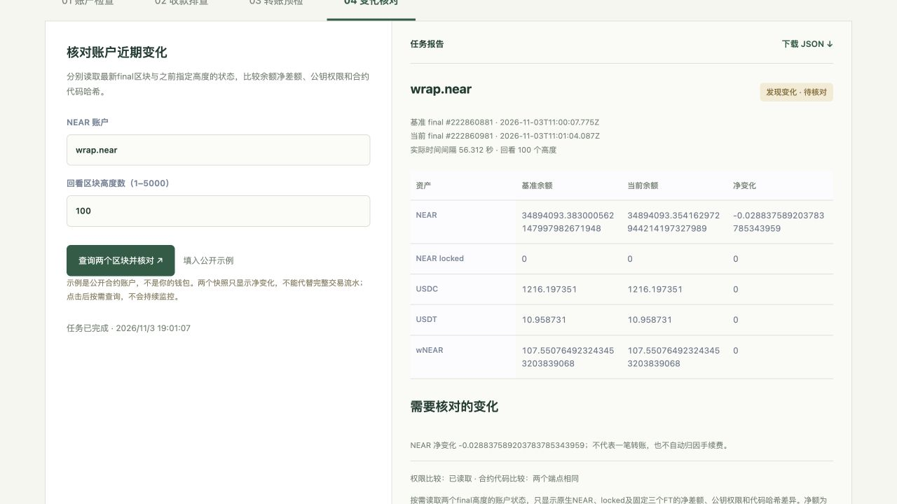
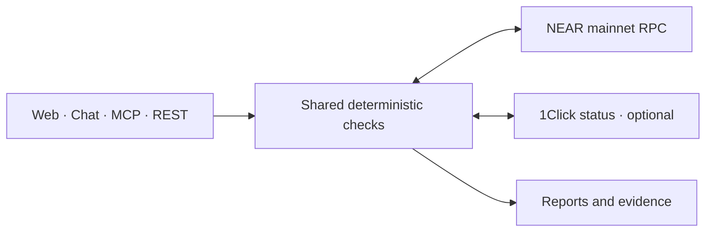

<div align="center">
  
  <h1>FlowTrace</h1>
  <p><strong>NEAR Agent Toolkit</strong></p>
  <p>Read the chain. Review the evidence.</p>
  <p>
    <a href="https://www.darkchunk.win/collect/agent/">Live demo</a> ·
    <a href="https://www.darkchunk.win/collect/agent/#changes">Account changes</a> ·
    <a href="public/agent/guide.md">MCP &amp; API guide</a> ·
    <a href="#quick-start">Quick start</a>
  </p>
  <p>
    <a href="LICENSE"></a>
    <a href="package.json"></a>
    <a href="#connect-your-agent"></a>
    <a href="#verification"></a>
  </p>
  <p><strong>English</strong> · <a href="README.zh-CN.md">简体中文</a></p>
</div>

FlowTrace gives people and AI agents a shared way to inspect NEAR accounts, compare changes, investigate payments, and check FT transfers before wallet review. One backend serves **8 MCP tools**, **4 task workflows**, a conversational interface, and manual forms.

Reports keep block anchors, data sources, query times, exact amounts, and unknown results visible. **Wallet keys and transaction signing stay with the user.**

<p align="center">
  <a href="https://www.darkchunk.win/collect/agent/#changes"></a>
  <br />
  <sub>A real public-account comparison captured on November 3, 2026. Historical observation; balances change.</sub>
</p>

## What you can do

| Your question | FlowTrace checks |
| --- | --- |
| **What is in this account?** | Native NEAR, USDC, USDT and wNEAR balances, plus direct access-key permissions. |
| **What changed recently?** | Exact balance deltas, added or removed keys, changed permissions, and contract-code hashes at two finalized heights. |
| **Did this payment arrive?** | A declared order against the net standard FT events in one finalized NEAR transaction, with optional 1Click status. |
| **Is this transfer ready for wallet review?** | FT balance, receiver and token-storage registration, native fee reserve, and an optional caller amount limit. |

Use the **web console** for manual checks, **chat** to ask in natural language, or **MCP / REST** from another application. You can download JSON reports and replay included payment evidence offline.

## Try the demo

1. Open [Account changes](https://www.darkchunk.win/collect/agent/#changes).
2. Click **填入公开示例** (Fill public example), then **查询两个区块并核对** (Compare).
3. Inspect both block anchors, the actual time interval, and any unknown checks. Download the JSON report.

For the chat interface, try:

> 核对 wrap.near 最近100个区块的余额和权限变化。
>
> Compare the balance and permission changes of wrap.near over the last 100 block heights.

`wrap.near` is a public example account; this project does not control it. A snapshot difference shows **net changes**, not every intervening transaction. The web UI is currently in Chinese; tool names and JSON schemas use English identifiers.

## Quick start

Requires **Node.js 22+** and npm.

```sh
git clone https://github.com/yinbowen-dc/FlowTrace.git
cd FlowTrace
npm ci
npm start
```

Open **http://127.0.0.1:8804/agent/**.

Manual forms, MCP and task APIs work without an AI key. Optional chat uses the server-side `OPENAI_API_KEY` configuration. See the [configuration guide](public/agent/guide.md) for model settings, limits and data handling.

```sh
# Run deterministic tests with fixtures
npm test

# Recheck the included historical payment evidence, offline
npm run replay -- examples/public-receipt-evidence.json
```

## Connect your agent

### Remote MCP

Endpoint: **https://www.darkchunk.win/collect/mcp**

Clients that support Streamable HTTP MCP can use this configuration; exact settings vary by client:

```json
{
  "mcpServers": {
    "flowtrace": {
      "url": "https://www.darkchunk.win/collect/mcp"
    }
  }
}
```

### Local stdio

Run `npm ci` first, then replace the path with your checkout:

```json
{
  "mcpServers": {
    "flowtrace": {
      "command": "node",
      "args": ["/absolute/path/to/FlowTrace/mcp/stdio.mjs"]
    }
  }
}
```

A runnable client example is included:

```sh
npm run agent:demo -- --stdio --account wrap.near
```

<details>
<summary><strong>Explore all 8 MCP tools</strong></summary>

| Tool | Purpose |
| --- | --- |
| `near_network_status` | Read the mainnet final block anchor. |
| `near_account_overview` | Read native NEAR and the three supported FT balances at one block. |
| `near_account_permissions` | Inspect direct account access keys and their permissions. |
| `near_account_changes` | Compare balances, permissions and code hashes across two finalized heights. |
| `near_verify_receipt` | Check the net FT event amount in a specific finalized transaction. |
| `intents_get_status` | Read a NEAR Intents 1Click channel-status report. |
| `near_investigate_payment` | Compare a payment claim with transaction evidence and optional channel status. |
| `near_transfer_preflight` | Check FT transfer conditions and prepare an unsigned wallet template. |

Discover exact inputs using `tools/list` or the [live catalog](https://www.darkchunk.win/collect/api/agent/catalog). The [integration guide](public/agent/guide.md) covers scope, limits, examples and the [companion Skill](public/agent/skills/near-agent-ops/SKILL.md).

</details>

## Use the REST API

This public example requests a read-only comparison:

```sh
curl https://www.darkchunk.win/collect/api/agent/run \
  -H 'Content-Type: application/json' \
  --data '{"task":"account_compare","input":{"accountId":"wrap.near","lookbackBlocks":100}}'
```

| Task | Use it for |
| --- | --- |
| `account_inspect` | Balances and access keys at a shared final block. |
| `account_compare` | Net account changes across two finalized heights. |
| `payment_investigate` | One order claim and its target FT transaction. |
| `transfer_preflight` | FT transfer checks and an unsigned request for wallet review. |

`lookbackBlocks` is an integer from **1 to 5000**, default **100**. It is a height difference; the report returns the actual time interval. Amount inputs use decimal strings and exact atomic units.

## How it works



The agent selects existing tools and explains their results. The backend reads fixed upstream providers and runs the same checks for every interface. The browser and offline payment-replay CLI share the payment rules.

## Scope and trust

- **Read-only operations and unsigned FT templates.** Signing, broadcasting, swaps, refunds and automated trading are outside this version.
- **Fixed asset coverage:** native NEAR plus USDC, USDT and wNEAR. Other tokens, NFTs, staking-pool shares and Intents internal balances are outside the account report.
- **Two snapshots show net differences.** Zero net movement does not establish inactivity; a key change does not establish theft. Historical-data failures remain unknown. Continuous monitoring and notifications are not implemented.
- **Payment association is declared by the caller.** One transaction does not prove invoice ownership, full cross-chain settlement or source-chain refunds. Channel success alone is not merchant-receipt proof.
- **Preflight is a rules check.** It is not contract simulation, a guarantee of execution, or an on-chain spending limit. FunctionCall key allowance is a gas budget, not a token budget.
- **RPC data is an upstream observation.** Reports are not independent light-client proofs. File hashes establish content integrity, not upstream authenticity.

Chat messages and needed tool results go to OpenAI; this service does not persist chat bodies. Imported orders stay in the browser's unencrypted localStorage. Public endpoints have rate and concurrency limits and no production SLA. More detail is in the [data and integration guide](public/agent/guide.md).

## Verification

The **v0.4 application baseline passed 76 tests** on Node.js 25.9.0 and 22.23.4. The suite covers receipt finality, exact amounts, unknown states, snapshot anchoring, permission changes, transfer limits, tool grounding and HTTP/stdio MCP.

Live mainnet, standard MCP-client, real model-tool and browser checks were performed separately. See the [historical verification record](examples/account-changes-verification.json) and [offline evidence](examples/README.md). These records describe past observations, not current balances or uptime guarantees.

## Next steps

Planned, not yet available:

- Persistent watchlists, scheduled collection and change notifications.
- Transaction-history indexing and merchant order-system integration.
- Authenticated team workspaces and production service controls.

## Contributing

Bug reports, clearer docs and focused improvements are welcome. Start with [CONTRIBUTING.md](CONTRIBUTING.md); include a reproducible example and the public identifiers needed to understand it.

## Project notes

Built for **NEAR HACKATHON 2026**, with AI coding assistance. Competition submission is pending; see [submission preparation](public/agent/submission.md). The existing hosting domain is deployment infrastructure, and the earlier market dashboard is not a source or runtime dependency.

FlowTrace uses the official MCP SDK, OpenAI Agents SDK, Zod, NEAR RPC, NearBlocks discovery and optional 1Click status. NearBlocks discovers sample identifiers; transaction evidence is read again through RPC. Dependencies retain their own licenses.

## License

[MIT](LICENSE) · FlowTrace contributors.
