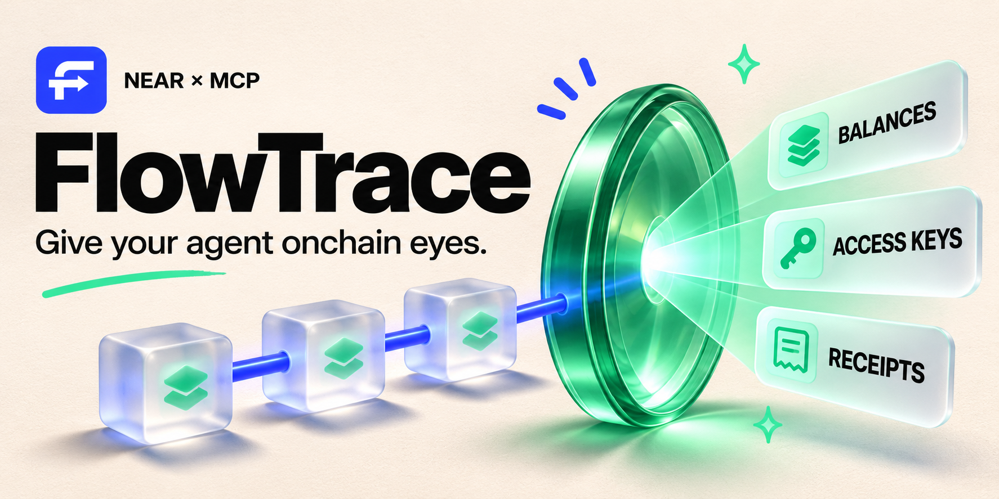
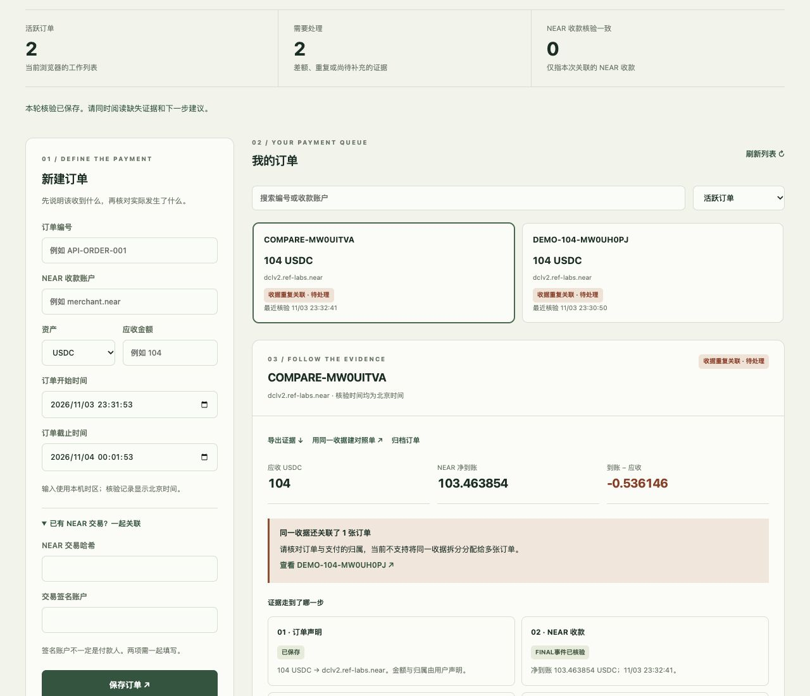
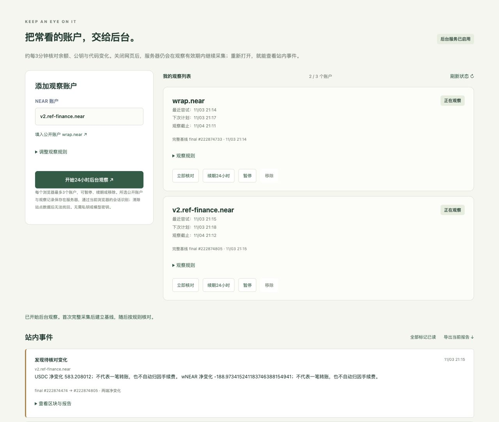
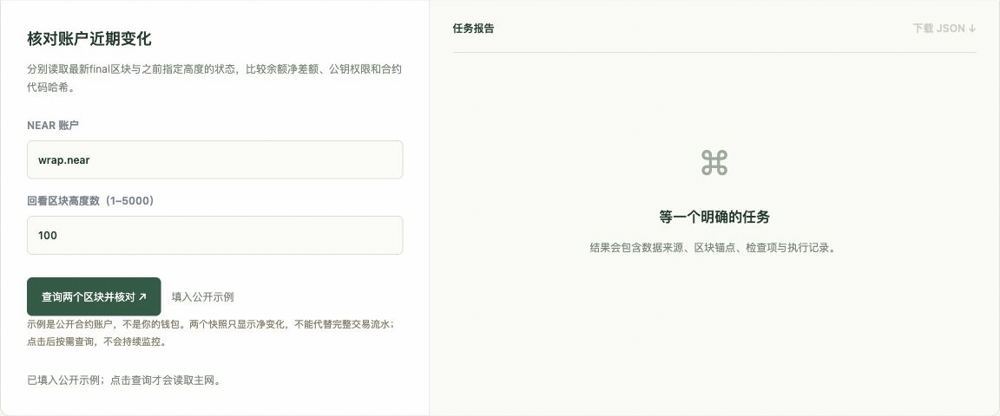
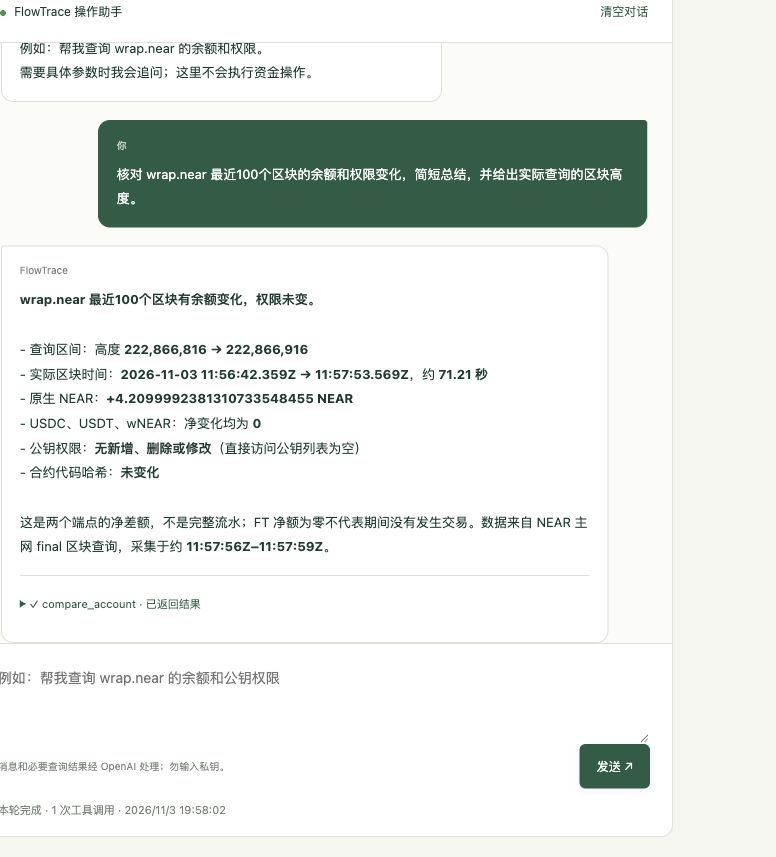
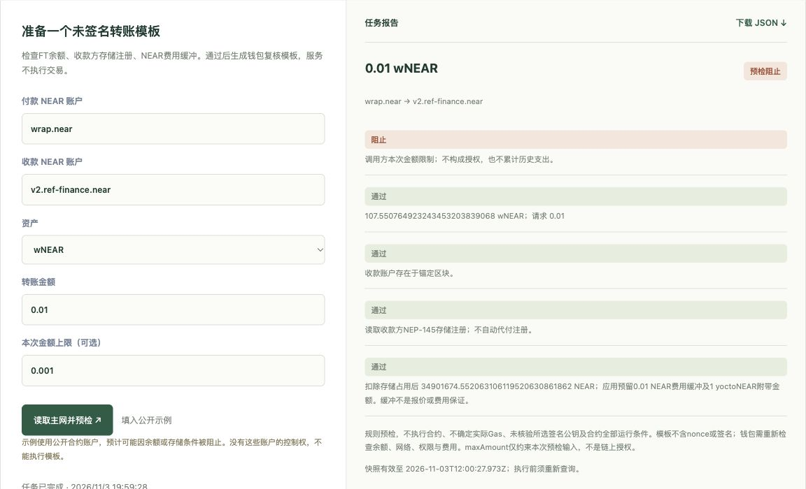

<p align="center">
  <a href="https://www.darkchunk.win/collect/agent/"></a>
</p>

<h2 align="center">给 Agent，一双链上眼睛。</h2>
<p align="center">一句话查账户 · 看余额和权限怎么变 · 转账前先查一遍</p>
<p align="center">
  <a href="https://www.darkchunk.win/collect/agent/"><strong>🚀 在线试试</strong></a> ·
  <a href="#-刚才账户里发生了什么">🎬 看真实演示</a> ·
  <a href="#-给你自己的-agent-也接上">🧩 接你的 Agent</a> ·
  <a href="README.md">English</a>
</p>
<p align="center"><strong>NEAR 主网</strong> · 8 个 MCP 工具 · <a href="LICENSE">MIT 开源</a></p>

## 🧾 这笔钱，走到哪一步了？

保存订单，关联真实交易，再把应收、实际到账和差额放在同一处核对。核验历史会保留；同一收据被多张订单引用时，两边都会提示。渠道报告与来源链证据分开展示，未知如实保留。

[](https://www.darkchunk.win/collect/agent/payments/)

<sub>2026-11-03 正式网站实拍。两张构造订单关联同一笔公开历史收据；没有执行资金操作。</sub>

**[打开支付排查工作台 →](https://www.darkchunk.win/collect/agent/payments/)** · [功能与接口说明](docs/PAYMENTS.md)

## 👁️ 后台盯账户，回来就看变化。

把常看的账户放进观察列表。服务器约每3分钟核对一次余额、公钥和代码；达到你设定规则的变化，会进入站内事件流。**关闭网页后也会继续采集**，默认每次观察24小时，可暂停、续期和导出报告。

每个浏览器最多3个账户。查询未知会保留上次完整基线；这是两端净变化观察，不是完整流水或被盗判定。

[](https://www.darkchunk.win/collect/agent/#watch)

<sub>2026-11-03 正式网站实拍。两个公开账户与后台自动产生的变化事件，数值为历史数据。</sub>

**[开启后台观察 →](https://www.darkchunk.win/collect/agent/#watch)** · [规则、数据与部署说明](docs/WATCH.md)

## 🔎 刚才，账户里发生了什么？

余额变了多少？有没有新增公钥？合约代码动过吗？

给一个账户，FlowTrace 把**余额净变化、权限变化、代码哈希变化**放进同一份报告。起点、终点区块一起给你，点开就能继续核对。

[](https://www.darkchunk.win/collect/agent/?demo=changes#manual)

<sub>2026-11-03 真实主网演示，等待时间已压缩。两个快照展示净变化，不是完整交易流水。</sub>

**[拿 wrap.near 试一把 →](https://www.darkchunk.win/collect/agent/?demo=changes#manual)**

## 🗣️ 一句话，让 Agent 去查

把这个问题丢进对话框：

```text
核对 wrap.near 最近100个区块的余额和权限变化。
```

它会调用链上工具，给出结果、区块高度和可展开的工具记录。想自己复核？直接把这次结果带到手动面板。

<p align="center">
  
</p>

<sub>截图为 2026-11-03 的真实工具调用，数值是当次查询的历史结果。</sub>

**[打开对话，问你自己的问题 →](https://www.darkchunk.win/collect/agent/#chat)**

## 🛑 想转 0.01，上限却只填了 0.001？

先把超限请求标出来，再去钱包复核。

FlowTrace 会检查 **FT 余额、收款账户、代币存储注册、费用缓冲和本次金额上限**。下面这个公开示例，实际触发了“预检阻止”：

[](https://www.darkchunk.win/collect/agent/?demo=limit#manual)

<sub>只读规则检查；截图中的金额上限只约束本次预检输入，不是链上授权或实际支出限额。</sub>

检查完成后，可生成供钱包复核的**未签名模板**。资金和签名留在你的钱包。

**[打开金额超限示例 →](https://www.darkchunk.win/collect/agent/?demo=limit#manual)**

## 💸 “这笔收款，和约好的金额对得上吗？”

给出应收金额、代币、收款方和目标交易，FlowTrace 会对照这笔交易的 **FT 事件净额**，列出差异与缺失证据。还可以补查 **1Click 渠道状态**。

适合支付排查、商户对账原型，以及需要读取收款证据的 Agent。订单关联由你声明；渠道成功和商家到账分开核对。

**[试试历史收款示例 →](https://www.darkchunk.win/collect/agent/?demo=receipt#manual)**

## 🧩 给你自己的 Agent 也接上

同一套工具，可以在网页里点，也可以接进支持 MCP 的客户端：

```json
{
  "mcpServers": {
    "flowtrace": {
      "url": "https://www.darkchunk.win/collect/mcp"
    }
  }
}
```

**查账户 → 对变化 → 查收款 → 做预检。** 每一步都有结构化结果，方便 Agent 继续用，也方便人下载复查。

<details>
<summary><strong>展开看 8 个 MCP 工具</strong></summary>

| 工具 | 能干什么 |
| --- | --- |
| `near_network_status` | 看主网状态与 final 区块锚点 |
| `near_account_overview` | 查 NEAR、USDC、USDT、wNEAR 余额 |
| `near_account_permissions` | 看账户直接访问公钥与权限 |
| `near_account_changes` | 对比两个区块的资产、权限和代码变化 |
| `near_verify_receipt` | 核对一笔最终确认交易的 FT 事件净额 |
| `intents_get_status` | 查 1Click 渠道状态 |
| `near_investigate_payment` | 将应收声明、交易证据和可选渠道状态放在一起排查 |
| `near_transfer_preflight` | 检查 FT 转账条件，准备未签名模板 |

</details>

[本机运行 / stdio / REST API →](docs/INTEGRATION.md) · [完整参数 →](public/agent/guide.md) · [配套 Skill →](public/agent/skills/near-agent-ops/SKILL.md)

## 🚀 现在就玩一遍

1. 打开[在线演示](https://www.darkchunk.win/collect/agent/?demo=changes#manual)，无需连接钱包。
2. 点击 **填入公开示例 → 查询两个区块并核对**。
3. 看变化、看区块，下载你的第一份 JSON 报告。

想跑自己的版本？**Node.js 22.16+**，四行启动：

```sh
git clone https://github.com/yinbowen-dc/FlowTrace.git
cd FlowTrace
npm ci
WATCH_DB_PATH=./runtime/watch.sqlite npm start
```

打开 [本机控制台](http://127.0.0.1:8804/agent/)。手动、MCP 和 REST 不需要模型密钥；AI 对话需服务端配置，见[接入指南](docs/INTEGRATION.md)。

## 🛠️ 已经能用，接着往前做

当前是 **v0.6.0 MVP**。网页对话、手动检查、8 个 MCP 工具、4 条任务流程已实现；v0.6.0 通过 **110 项测试**，真实主网、MCP 客户端和模型工具调用另行核验。

已加入**服务器观察列表、周期采集和站内事件**。下一步继续扩展历史流水与商家订单系统对接；这些扩展尚未实现。

[执行计划 →](docs/PLAN.md) · [v0.6.0 更新 →](docs/RELEASE-v0.6.0.md) · [提个想法或 Bug →](https://github.com/yinbowen-dc/FlowTrace/issues) · [参与贡献 →](CONTRIBUTING.md) · [主网核验记录 →](examples/account-changes-verification.json) · [离线支付证据 →](examples/README.md)

<details>
<summary>使用前了解一下：数据、范围与限制</summary>

- MCP 与单次任务按需查询；网页可单独开启有期限的后台观察和站内事件，不含外部通知或套利执行。
- 账户资产覆盖原生 NEAR 和 USDC、USDT、wNEAR；不含其他 FT、NFT、质押池份额或 Intents 内部余额。
- 两个快照只显示净变化。净额为零不代表没发生交易，公钥变化也不等于被盗。历史查询失败保留未知。
- 单笔收款核对不证明订单归属、整条跨链结算或来源链退款；渠道成功不能单独证明商家到账。
- 转账预检不是合约仿真或执行保证。不持有私钥，不签名、广播、兑换或退款。FunctionCall key 的 allowance 是 Gas 预算。
- 对话消息和必要工具结果会发送 OpenAI，本服务不持久化对话正文。后台观察会保存单独启用的账户、基线和事件，使用浏览器会话隔离；见[观察数据说明](docs/WATCH.md)。支付工作台另行在服务端保存订单、关联和核验历史，见[支付数据说明](docs/PAYMENTS.md)。原收款回放页导入的订单留在浏览器未加密的 localStorage；不要输入私钥、助记词或 API 密钥。
- 公共服务有速率与并发限制，无生产 SLA；RPC 数据是上游观察，不是独立轻客户端证明。网页当前为中文。

完整说明见[数据与接口文档](public/agent/guide.md)。[视觉素材来源](docs/assets/README.md)。

</details>

---

为 **NEAR HACKATHON 2026** 构建，使用 AI 编程辅助；比赛报名待提交，见[报名准备](public/agent/submission.md)。沿用既有域名部署，之前的看盘网站不是源码或运行依赖。

使用官方 MCP SDK、OpenAI Agents SDK、Zod、NEAR RPC、NearBlocks 样本发现和可选 1Click 状态服务，各自保留原有许可。**[MIT](LICENSE) · FlowTrace contributors**
