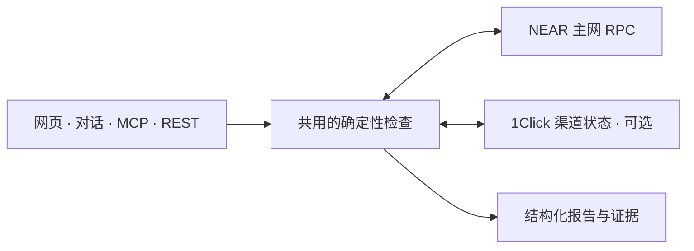

<div align="center">
  
  <h1>FlowTrace</h1>
  <p><strong>NEAR Agent Toolkit · 给 Agent 和人使用的链上数据工具</strong></p>
  <p>读懂链上状态，让每次检查都有依据。</p>
  <p>
    <a href="https://www.darkchunk.win/collect/agent/">在线体验</a> ·
    <a href="https://www.darkchunk.win/collect/agent/#changes">账户变化核对</a> ·
    <a href="public/agent/guide.md">MCP 与 API 文档</a> ·
    <a href="#本机运行">本机运行</a>
  </p>
  <p>
    <a href="LICENSE"></a>
    <a href="package.json"></a>
    <a href="#接入-agent"></a>
    <a href="#验证情况"></a>
  </p>
  <p><a href="README.md">English</a> · <strong>简体中文</strong></p>
</div>

FlowTrace 帮助用户和 AI Agent 查询 NEAR 账户、核对近期变化、排查收款，以及检查 FT 转账条件。同一套后端提供 **8 个 MCP 工具、4 个任务流程、对话入口和手动表单**。

报告保留区块锚点、来源、查询时间、精确金额和未知项。**资金留在用户钱包，签名仍由用户完成。**

<p align="center">
  <a href="https://www.darkchunk.win/collect/agent/#changes"></a>
  <br />
  <sub>2026 年 11 月 3 日采集的真实公开账户演示；截图是历史观察，不代表当前余额。</sub>
</p>

## 能解决什么问题

| 你想知道什么 | FlowTrace 会检查什么 |
| --- | --- |
| **账户里有哪些资产？** | 原生 NEAR、USDC、USDT、wNEAR 余额及直接访问公钥权限。 |
| **最近发生了哪些变化？** | 两个 final 高度之间的余额净差额、公钥增删、权限和合约代码哈希变化。 |
| **客户这笔钱到账了吗？** | 应收声明与一笔最终确认交易中的 FT 事件净额；可补查 1Click 渠道状态。 |
| **这笔转账是否适合交给钱包复核？** | FT 余额、收款方账户与代币存储注册、原生费用缓冲，以及可选的本次金额上限。 |

可以通过网页手动操作，也可以让对话助手、MCP 客户端或 REST 调用同一套检查。结果可下载为 JSON，附带的支付证据可在本机离线重跑。

## 先体验一次

1. 打开[账户变化核对](https://www.darkchunk.win/collect/agent/#changes)。
2. 点击 **填入公开示例 → 查询两个区块并核对**。
3. 查看起止区块、实际时间间隔、余额差额与未知项，下载 JSON 复核。

也可以在对话框输入：

> 核对 wrap.near 最近100个区块的余额和权限变化。

`wrap.near` 是公开合约账户，项目不控制这个账户。两个快照只展示**净变化**，不等于完整交易流水。网页界面目前为中文；工具名称和 JSON Schema 使用英文标识。

## 本机运行

需要 **Node.js 22+** 和 npm。

```sh
git clone https://github.com/yinbowen-dc/FlowTrace.git
cd FlowTrace
npm ci
npm start
```

打开 **http://127.0.0.1:8804/agent/**。

手动表单、MCP 和任务 API 无需模型密钥。可选的 AI 对话使用服务端 `OPENAI_API_KEY`，配置与数据处理方式见[接入文档](public/agent/guide.md)。

```sh
# 使用确定性夹具运行测试
npm test

# 离线重跑附带的历史支付证据
npm run replay -- examples/public-receipt-evidence.json
```

## 接入 Agent

远程 MCP 地址：**https://www.darkchunk.win/collect/mcp**。

支持 Streamable HTTP MCP 的客户端可参考以下配置；具体字段以客户端为准：

```json
{
  "mcpServers": {
    "flowtrace": {
      "url": "https://www.darkchunk.win/collect/mcp"
    }
  }
}
```

本机 stdio 配置，先运行 `npm ci`，并替换实际仓库路径：

```json
{
  "mcpServers": {
    "flowtrace": {
      "command": "node",
      "args": ["/absolute/path/to/FlowTrace/mcp/stdio.mjs"]
    }
  }
}
```

仓库附带真实客户端示例：

```sh
npm run agent:demo -- --stdio --account wrap.near
```

八个工具分别为 `near_network_status`、`near_account_overview`、`near_account_permissions`、`near_account_changes`、`near_verify_receipt`、`intents_get_status`、`near_investigate_payment`、`near_transfer_preflight`。

完整输入字段见[在线工具目录](https://www.darkchunk.win/collect/api/agent/catalog)、[接入文档](public/agent/guide.md)和[配套 Skill](public/agent/skills/near-agent-ops/SKILL.md)。

## 直接调用 API

下面的请求只读取公开账户状态：

```sh
curl https://www.darkchunk.win/collect/api/agent/run \
  -H 'Content-Type: application/json' \
  --data '{"task":"account_compare","input":{"accountId":"wrap.near","lookbackBlocks":100}}'
```

| 任务 | 用途 |
| --- | --- |
| `account_inspect` | 在同一个 final 区块读取资产和公钥。 |
| `account_compare` | 对比两个已最终确认高度的账户净变化。 |
| `payment_investigate` | 核对一笔应收声明及其目标 FT 交易。 |
| `transfer_preflight` | 预检 FT 转账并生成供钱包复核的未签名模板。 |

`lookbackBlocks` 必须是 **1–5000 的整数**，默认 **100**。它是区块高度差，实际时间间隔由报告返回。金额使用十进制字符串和精确最小单位。

## 数据如何流动



Agent 负责选择已有工具和解释结果；后端从固定上游读取数据并执行规则。浏览器与离线重跑 CLI 共用支付核验逻辑。

## 当前范围

- 提供**只读查询和未签名 FT 模板**；不托管密钥、签名、广播、兑换、退款或自动交易。
- 资产查询覆盖原生 NEAR 与固定三个 FT；其他代币、NFT、质押池份额及 Intents 内部余额不在范围内。
- 两个快照的净额为零不代表期间没有交易；公钥变动也不等于被盗。历史查询失败保留未知。尚未提供常驻监控和主动提醒。
- 订单关联由调用方声明，单笔交易不能证明发票归属、完整跨链结算或来源链退款。渠道成功不能独立证明商家到账。
- 转账预检是规则检查，不是合约仿真、执行保证或链上支出限额。FunctionCall key 的 allowance 是 Gas 预算。
- RPC 响应属于上游观察，不是独立轻客户端证明；文件摘要只检查内容一致性。

对话消息和必要工具结果会发送 OpenAI，本服务不持久化对话正文。导入订单保存在浏览器未加密的 localStorage。公开服务有速率、并发限制，无生产 SLA。详见[接入与数据说明](public/agent/guide.md)。

## 验证情况

**v0.4 应用基线的 76 项测试**已在 Node.js 25.9.0 和 22.23.4 通过，覆盖最终确认、金额精度、未知状态、快照锚定、权限变化、转账上限、工具参数和 HTTP/stdio MCP。

真实主网、标准 MCP 客户端、模型工具调用和浏览器另行核验。可查看[历史验证记录](examples/account-changes-verification.json)与[离线证据](examples/README.md)；这些记录不代表当前余额或未来可用性。

## 后续方向

以下能力尚未实现：

- 持久化观察列表、定时采集及变化通知。
- 历史交易索引与商家订单系统对接。
- 带鉴权的团队工作区与生产服务控制。

## 参与贡献

欢迎提交可复现的问题、文档改进和范围清楚的 PR。参见[贡献说明](CONTRIBUTING.md)。

## 项目说明

为 **NEAR HACKATHON 2026** 构建，开发过程使用了 AI 编程辅助。比赛尚未提交，参见[报名准备](public/agent/submission.md)。既有域名仅作部署基础设施，之前的看盘网站不是本项目的源码或运行依赖。

使用官方 MCP SDK、OpenAI Agents SDK、Zod、NEAR RPC、NearBlocks 样本发现与可选 1Click 状态服务；这些上游服务与库保留各自许可，不能算作本项目的原创实现。

## 许可证

[MIT](LICENSE) · FlowTrace contributors。
