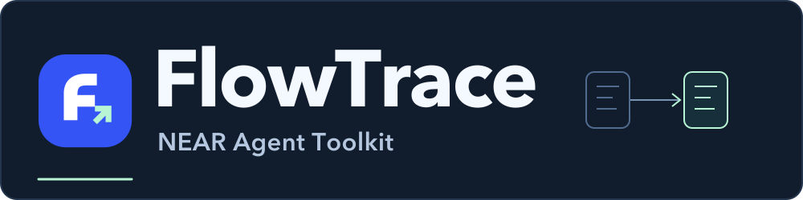
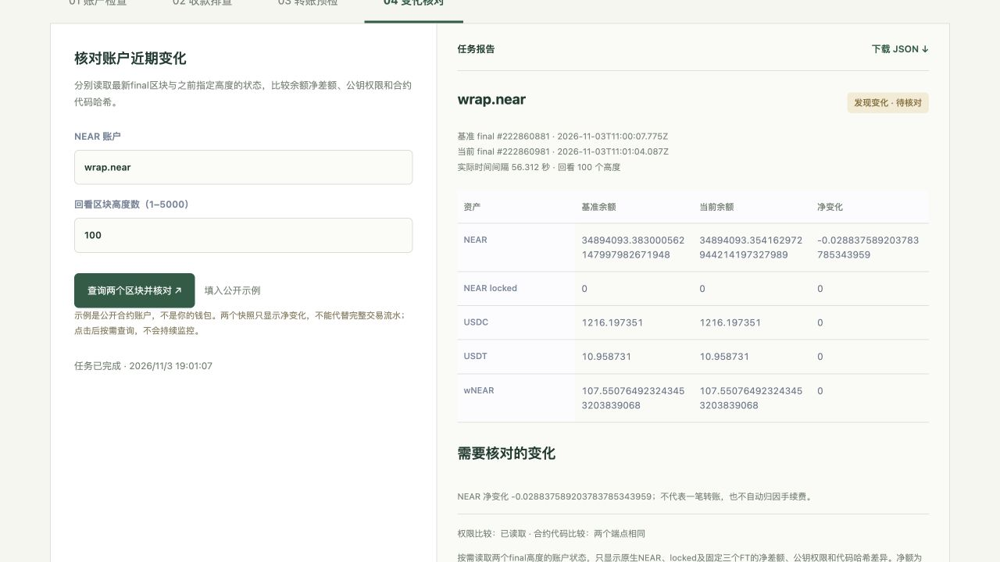

  

[English](README.md) · **简体中文**

**给用户和 AI Agent 使用的 NEAR 账户与支付检查工具。**

输入账户地址或交易信息，FlowTrace 从 NEAR 主网读取数据，返回余额、权限、收款或转账条件的检查报告。你可以在网页里操作，也可以让 Agent 通过 MCP 调用。

[在线体验 →](https://www.darkchunk.win/collect/agent/)　[开发接入 →](docs/INTEGRATION.md)

## 当前状态

| 项目 | 现在的情况 |
| --- | --- |
| 版本 | **v0.4 · MVP 演示版** |
| 网络 | **NEAR 主网**，通过 RPC 按次查询 |
| 入口 | 网页表单、AI 对话、MCP、REST API |
| 资产范围 | 原生 NEAR，以及 USDC、USDT、wNEAR |
| 验证记录 | v0.4 基线已通过 76 项测试；[主网核验记录](examples/account-changes-verification.json)单独保存 |

**这是按需检查工具。后台持续监控、自动告警和套利执行尚未实现。**

## 现在能做什么

### 1. 查看账户

- **输入：** NEAR 账户地址。
- **得到：** NEAR 和三个支持代币的余额、账户公钥及其权限。
- **适用：** 了解账户资产、检查有哪些公钥可以操作账户。

### 2. 比较账户变化

- **输入：** 账户地址、回看区块数，默认 100。
- **得到：** 两个已最终确认区块之间的余额净变化、公钥增删、权限及合约代码哈希变化。
- **适用：** 快速核对最近发生了什么，再按报告中的区块锚点复查。

### 3. 核对收款

- **输入：** 预期收款金额、代币、收款地址、交易哈希及付款方等信息。
- **得到：** 这笔 FT 交易的事件净额与应收声明是否一致；可补查 1Click 渠道状态。
- **适用：** 排查“这笔付款和我预期的收款是否一致”。

### 4. FT 转账前检查

- **输入：** 付款账户、收款地址、USDC / USDT / wNEAR、金额及可选的本次金额上限。
- **得到：** 余额、收款账户、代币存储注册、费用缓冲等检查结果，以及可选的未签名模板。
- **适用：** 在交给钱包复核前，先发现常见条件缺失。

以上是 **4 个业务流程**，后端拆成 **8 个 MCP 工具**供 Agent 使用。它们共享同一套检查逻辑。

## 怎么体验

第一次建议用公开示例，不需要连接钱包：

1. 打开[账户变化核对](https://www.darkchunk.win/collect/agent/#changes)。
2. 点击 **填入公开示例 → 查询两个区块并核对**。
3. 查看起止区块、实际时间间隔与变化项；可下载 JSON 报告。

也可以在[对话入口](https://www.darkchunk.win/collect/agent/)输入：

> 核对 wrap.near 最近100个区块的余额和权限变化。

对话达到用量限制或模型不可用时，可以继续使用手动表单。网页目前为中文，接口名称使用英文。

### 界面预览

*截图采集于 2026 年 11 月 3 日，展示公开账户 wrap.near 的一次历史查询。它不是实时画面。*

## 数据从哪里来

**你的问题 → 网页 / Agent → 共用检查服务 → NEAR 主网 RPC → 检查报告**

- 账户查询锚定已最终确认的区块；变化核对读取两个区块的状态。
- 支付排查按需补查 1Click 状态。渠道状态与链上收款证据分别展示。
- 报告保留区块、来源、查询时间、精确金额和未知项；AI 负责选择工具、解释结果。

## 当前范围

- **账户变化是两个快照的净差额。** 不是完整交易流水；净额为零仍可能发生过交易。
- **预检通过仍需钱包复核。** 本版不持有私钥、不签名、不广播，也不自动兑换或退款。
- **资产范围固定。** 其他代币、NFT、质押池份额和 Intents 内部余额尚未覆盖。
- **结果有明确边界。** 公钥变化不等于被盗；单笔收款核对不证明订单归属或整条跨链结算；转账预检不是合约仿真或执行保证。

数据处理与公共服务限制

- 对话消息和必要工具结果会发送 OpenAI；本服务不持久化对话正文。手动查询不经过模型。
- 导入订单保存在浏览器未加密的 localStorage。不要输入私钥、助记词或 API 密钥。
- 公共服务有速率与并发限制，无生产 SLA。RPC 数据是上游观察，不是独立轻客户端证明。
- 历史查询失败保留未知，不会当成零余额或没有变化。
- 本次金额上限是输入规则，不是链上支出限额；FunctionCall key 的 allowance 是 Gas 预算。

完整说明见[参数、数据与边界](public/agent/guide.md)。

## 开发与文档

| 你想做什么 | 从这里开始 |
| --- | --- |
| 本机运行、接入 MCP 或调用 REST | [开发接入指南](docs/INTEGRATION.md) |
| 查看 8 个工具及完整参数 | [中文接口说明](public/agent/guide.md) · [在线工具目录](https://www.darkchunk.win/collect/api/agent/catalog) |
| 给 Agent 配置操作规则 | [配套 Skill](public/agent/skills/near-agent-ops/SKILL.md) |
| 查看测试与历史证据 | [账户变化核验](examples/account-changes-verification.json) · [支付证据重跑](examples/README.md) |
| 报告问题、参与开发 | [贡献说明](CONTRIBUTING.md) |

下一步计划是观察列表、定时采集与变化通知，以及历史流水与商家订单系统对接；**这些功能尚未上线**。

---

为 NEAR HACKATHON 2026 构建，使用 AI 编程辅助。比赛报名待提交，见[报名准备](public/agent/submission.md)。本项目沿用既有域名部署，之前的看盘网站不是源码或运行依赖。

使用官方 MCP SDK、OpenAI Agents SDK、Zod、NEAR RPC、NearBlocks 样本发现和可选 1Click 状态服务。上游服务与库保留各自许可。[MIT](LICENSE) · FlowTrace contributors。
